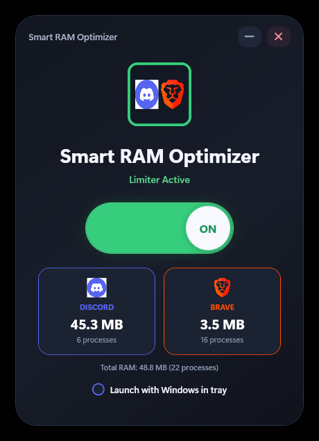

# Smart RAM Optimizer

A small Windows tray app that keeps the RAM usage of the apps you choose low while they run.

It started as a Discord-only RAM limiter and later gained Brave support. Those two are still the defaults, but you can now add any application and switch each one on or off.



## What it does

- Lists the apps it manages, each with its own on/off switch, live RAM usage and process count.
- **Add application** shows what is running right now, largest first, or lets you browse for an `.exe`. Each app is marked **Good to optimize**, **Not recommended**, or left unmarked when the optimizer has no opinion. Point at a row in the main list to show its remove button.
- Shows what it has achieved: memory freed right now, memory freed this session, and overall system memory.
- Lives in the system tray: the minimize and close buttons both hide the window. Quit from the settings menu (gear button) or the tray icon's **Exit**.
- Remembers your apps and settings between runs.
- Optional **Launch with Windows**, which starts it hidden in the tray.

It no longer starts Discord by itself, and it no longer exits when your apps close. It sits in the tray and waits for them.

## How it works

Every app in the list is a name plus the process names that belong to it (for example `Discord`, `DiscordCanary`, `DiscordPTB`). A background loop in `RamLimiterService` repeats:

1. Take one snapshot of all running processes and pick out the ones that belong to your apps.
2. For each app that is due, call the Windows API `SetProcessWorkingSetSize(handle, -1, -1)` on its processes. This asks Windows to move the process's pages out of physical RAM.
3. Measure again to see what the trim achieved, and send the numbers to the window.
4. Wait (2 seconds while the window is open, 5 seconds while it is hidden) and repeat.

### Gentle and aggressive mode

**Gentle (default).** An app is trimmed only when it is in the background, has been there for at least 30 seconds, is using more than 100 MB, and was not trimmed in the last 30 seconds. The app you are working in is left alone and its row says "in use".

**Aggressive** (settings menu). Every app is trimmed every 1.5 seconds, including the one you are using. This is how the app used to behave. It frees more, but the app being trimmed can stutter.

### What "limiting" really means

Trimming does not make an app need less memory. Windows moves its pages to the standby list or the page file, and the app pulls them back in when it touches them again. The freed RAM is available to other programs, but an app that is trimmed while busy may feel slower for a moment when you switch back to it. Turn off an app's switch if that bothers you.

### What the stats mean

- **Freed right now**: what your optimized apps held just before they were trimmed, minus what they have taken back since. Memory an app released by itself is not counted.
- **Freed this session**: everything trimmed since the optimizer started. The same memory can be counted more than once if an app takes it back and it is trimmed again.
- **System memory**: physical RAM in use across the whole PC.

### Safety

- Windows system processes (`csrss`, `lsass`, `svchost`, `dwm`, anything in the Windows folder, and so on) cannot be added.
- Apps marked **Not recommended** in the picker need a confirmation before they are added, and the message says why. There are three kinds:
  - Games and launchers protected by anti-cheat (Valorant and the Riot Client, Fortnite, Roblox and so on). Touching their memory from another program can get you kicked or flagged.
  - Recording, streaming and audio-mixing apps such as OBS. They work in real time in the background, so trimming them causes dropped frames and glitches.
  - Virtual machines and Android emulators, which slow to a crawl when their memory is pushed to disk.
- Apps marked **Good to optimize** are known memory-heavy apps that cope well with trimming: browsers (Chrome, Edge, Brave, Firefox, Opera, Vivaldi), chat apps (Discord, Slack, Teams, Telegram, WhatsApp, Signal), launcher helpers (Steam WebHelper, Epic Games Launcher, Battle.net, EA Desktop, GOG Galaxy, Ubisoft Connect), Spotify and a few Electron tools.
- Both lists live in `Services/AppRules.cs`. They are hand-picked from how these apps are known to behave, so treat an unmarked app as "probably fine, try it" and a warning as worth heeding.
- Apps running as administrator cannot be trimmed unless the optimizer is also run as administrator. Their row says "needs administrator".

## Settings

Settings are stored in `%AppData%\SmartRamOptimizer\settings.json`. Unexpected errors are written to `error.log` in the same folder. Only one copy of the optimizer runs at a time; starting it again brings up the existing window.

## Support button

The **Buy us a coffee** button at the bottom of the window opens a donation page in the default browser. It ships with a placeholder link, and while the placeholder is in place the button only shows a "not set up yet" message. To switch it on:

1. Create an account at [Buy Me a Coffee](https://www.buymeacoffee.com/) or [Ko-fi](https://ko-fi.com/).
2. Claim your page link, for example `https://buymeacoffee.com/myteam`.
3. Connect a payout method (Stripe or PayPal) in that site's settings so donations can reach you.
4. Replace `YOUR_USERNAME` in `CoffeeUrl` in `SmartRamOptimizer/AppConfig.cs` with your page name (or replace the whole link if you use Ko-fi) and rebuild. The link must start with `https://`.

## Project layout

```text
SmartRamOptimizer.sln
SmartRamOptimizer/
├── Services/
│   ├── RamLimiterService.cs  background measure-and-trim loop
│   ├── ProcessTools.cs       trim a process, find its exe, read system memory
│   ├── NativeMethods.cs      the Windows API declarations
│   ├── AppRules.cs           protected processes, warnings and recommendations
│   ├── RunningAppFinder.cs   builds the "Add application" list
│   ├── IconService.cs        reads an app's icon from its exe
│   ├── SettingsService.cs    loads and saves settings.json
│   ├── StartupService.cs     "launch with Windows" registry entry
│   ├── SingleInstance.cs     one running copy per user
│   ├── TrayIcon.cs           tray icon and its menu
│   └── ErrorLog.cs           error.log
├── Models/
│   ├── AppSettings.cs        what is saved between runs
│   └── MemorySnapshot.cs     the data sent from the loop to the window
├── ViewModels/               state behind the two windows
├── Assets/                   the app's own icon
├── AppConfig.cs              the support-button link
├── MainWindow.xaml(.cs)      application list and stats
├── AddAppWindow.xaml(.cs)    "Add application" picker
└── App.xaml(.cs)             startup, tray, shared styles, the --minimized argument
```

## Requirements

- Windows 10 or 11 (x64)
- [.NET 10 Desktop Runtime](https://dotnet.microsoft.com/download/dotnet/10.0) to run, or the .NET 10 SDK to build

## Build and run

```powershell
dotnet build .\SmartRamOptimizer.sln -c Release
```

```powershell
.\SmartRamOptimizer\bin\Release\net10.0-windows\SmartRamOptimizer.exe
```

Add `--minimized` to start hidden in the tray, which is what the "Launch with Windows" option does.

## License

MIT. See [LICENSE](LICENSE).
